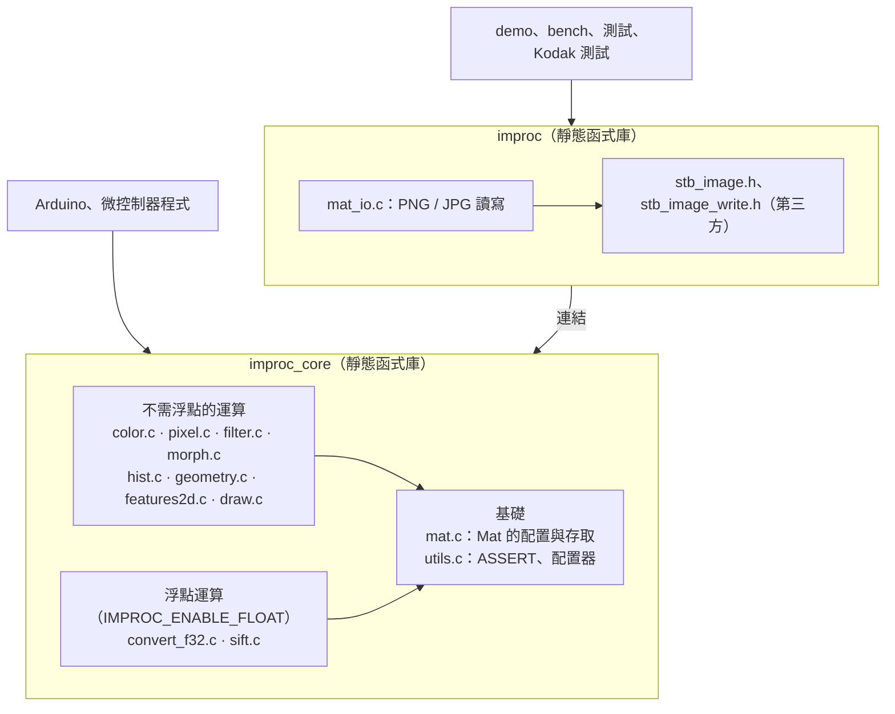
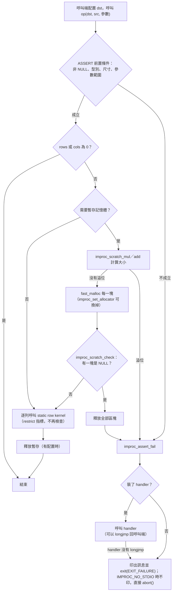
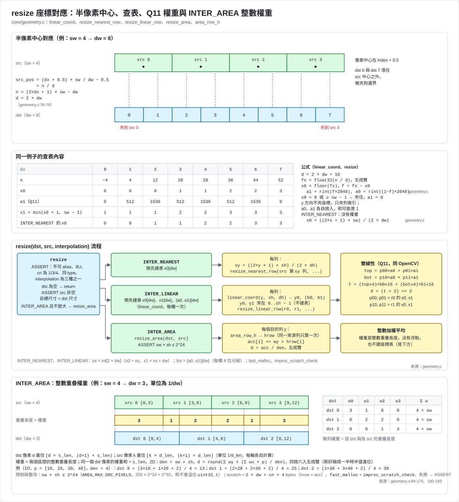
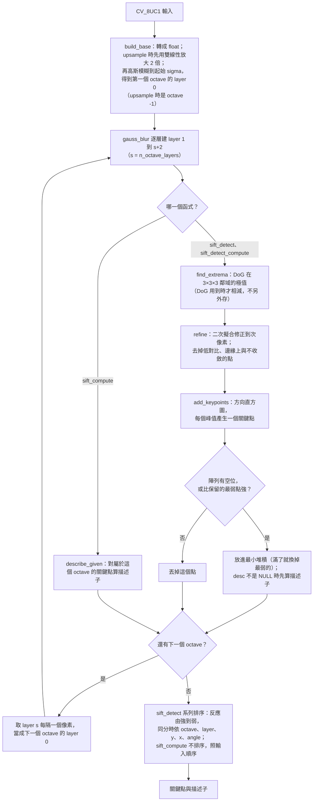
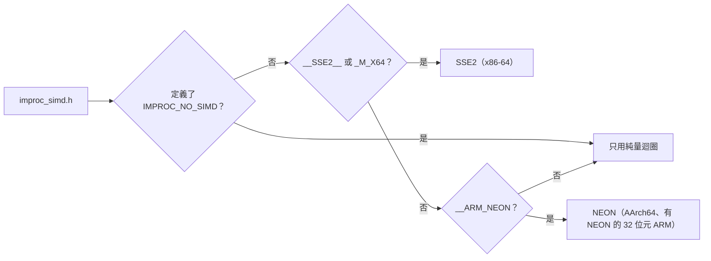

# 程式架構圖

這些圖對應目前的程式碼，包含 SIMD 路徑與浮點模組。C 沒有繼承，所以「關係圖」畫的是連結相依、`#include` 關係與 `struct Mat` 的資料模型，而不是類別階層。

圖 1、3、7、8 是 Mermaid 文字圖，GitHub 會直接畫出來；圖 2、4、5、6 是手寫 SVG。`tools/check_arch_doc.py` 檢查圖 1、內部標頭表與文件裡的路徑和程式碼一致（檢查項目見最後的維護方式），CI 的 Linux 工作會執行它；其他圖靠人工核對。

標示慣例：識別字、型別、算式照程式碼用英文；說明文字用繁體中文。SVG 圖的顏色如下：

| 顏色 | 意義 |
|---|---|
| 藍 | 公開 API |
| 綠 | 資料（`Mat`、緩衝區、表） |
| 黃 | 內部 `static` 函式與輔助程式 |
| 紫 | 執行檔、CMake 目標、呼叫端 |
| 灰 | 第三方或系統（stb、libc、檔案） |
| 紅 | `ASSERT` 與錯誤路徑 |

## 1. 模組與建置目標

`improc_core` 是可攜核心：八個不需浮點的運算模組、兩個浮點模組（`IMPROC_ENABLE_FLOAT=OFF` 時不編譯），加上 `mat` 與 `utils`。它不用 pthread 與檔案 IO；stdio 只在 `utils.c` 印出 `ASSERT` 訊息時用到，定義 `IMPROC_NO_STDIO` 就拿掉。`color.c` 在 x86-64 與 AArch64 上、開啟浮點、沒有定義 `IMPROC_NO_SIMD`，且編譯器以 float 精度計算浮點（`FLT_EVAL_METHOD` 為 0）時用硬體浮點算 HSV，其他情況用整數模擬，輸出相同。`improc` 在它之上加 `mat_io.c`（圖檔讀寫，只有這個檔案 include 第三方的 stb），並連結 Threads。`improc.h` 是 umbrella header，include 全部公開標頭。

各運算模組的標頭都 include `mat.h`；每個 `.c` 都 include 自己的標頭，多數也 include `utils.h`（`ASSERT` 與配置器）。除此之外，`.c` 檔之間的跨模組 include 只有 `hist.c` 用到 `pixel.h`。下列內部標頭不在 `improc.h` 內，只給核心與測試使用：

| 內部標頭 | 內容 | include 它的檔案 |
|---|---|---|
| `improc_internal.h` | 暫存大小的溢位檢查、128 位元輔助函式，以及給測試呼叫的內部函式（Harris、ORB 角度、`resize` 座標、等化查表） | `features2d.c`、`filter.c`、`geometry.c`、`hist.c`、`mat.c`、`morph.c`、`sift.c`、`utils.c` |
| `improc_simd.h` | SSE2 與 NEON 的 128 位元向量介面（見圖 8） | `filter.c`、`geometry.c`、`morph.c` |
| `median_net.h` | `ksize` 3 與 5 的中值比較網路（SIMD 路徑用），由 `tools/gen_median_net.py` 產生 | `filter.c` |

對應檔案：`CMakeLists.txt`、`core/improc.h`、`core/improc_internal.h`。

## 2. struct Mat 資料模型

`flags` 是 `uint32_t`，由幾個欄位組成：高 16 位是魔術數字 `MAGIC_VAL`，位元 12 是 `MAT_FLAG_HEAP`（`alloc_mat` 設定，表示資料由 Mat 擁有），位元 11..3 存「通道數減 1」，位元 2..0 存 depth；低 12 位合起來就是 type。`dims` 是 `int`，`size[2]` 與 `step[2]` 直接放在標頭內。`step[0]` 是一列的位元組數，`step[1]` 是一個像素的位元組數；資料是 interleaved 排列，列尾沒有 padding，所以 `mat_row` 與 `mat_at` 都用同一條位址算式。`alloc_mat` 用 16-byte 對齊的 `fast_malloc` 配置兩塊（標頭與資料），`free_mat` 檢查 `MAT_FLAG_HEAP` 後一次釋放。`mat_init` 則在呼叫端的緩衝區上建立標頭，完全不配置記憶體，沒有 malloc 的目標用它。

對應檔案：`core/mat.h`、`core/mat.c`、`core/utils.c`。

## 3. 運算函式的共同流程

呼叫端先配置 `dst`，運算函式再用 `ASSERT` 檢查前置條件。`ASSERT` 失敗時呼叫 `improc_assert_fail`：如果用 `improc_set_assert_handler` 裝了 handler，就先呼叫它（handler 可以 `longjmp` 回到呼叫端）；handler 沒有接手時，才印訊息並 `exit(EXIT_FAILURE)`，定義 `IMPROC_NO_STDIO` 時改成 `abort()`。`rows` 或 `cols` 為 0 的空影像是合法輸入（資料指標可以是 `NULL`）。有 `dst` 的運算在前置條件檢查通過後就結束，不再檢查 `dst` 與 `src` 的資料是否重疊，也不配置暫存；`resize` 與 `crop` 看的是 `dst` 是否為空，`dst` 非空時 `src` 必須非空。沒有 `dst` 的運算（直方圖、特徵點、SIFT、`otsu_threshold`）照常執行，只是沒有像素可處理：`otsu_threshold` 仍配置 1 KB 的直方圖並回傳 0；`sift_compute` 與 `orb_compute` 在關鍵點數大於 0 時要求影像非空。暫存大小與影像尺寸有關的運算用 `improc_scratch_mul` / `improc_scratch_add` 檢查大小（大小固定的直接用常數），再用 `fast_malloc`（可用 `improc_set_allocator` 換掉配置器）配置，最後由 `improc_scratch_check` 檢查：只要有一塊是 `NULL`，就先釋放全部區塊再 `ASSERT`，所以 handler 用 `longjmp` 也不會漏記憶體。通過檢查後逐列呼叫帶有 `restrict` 的 `static` row kernel，每個 kernel 只處理一列、不做檢查。`dst` 一律由呼叫端配置，運算不支援 in-place；繪圖函式（`draw_*`）是例外，直接畫在傳入的影像上；`resize` 與 `crop` 的輸出尺寸就是 `dst` 的尺寸。

選擇 row kernel 的方式依運算而定：`cvt_color` 掃描一張 29 列的轉換表（`code`、來源與目的通道數、kernel；含 HSV、YUV，以及相機格式 RGB565 與 YUYV），`threshold` 用 `switch` 依門檻種類選，`mat_lut`、`convert_scale_abs` 直接呼叫同一個 kernel，`convert_scale` 先建 256 項查表再交給 `mat_lut` 的 kernel。

對應檔案：`core/color.c`、`core/pixel.c`、`core/geometry.c`、`core/utils.h`、`core/utils.c`、`core/improc_internal.h`。其他模組的前置條件寫法與此相同。

## 4. 可分離濾波

`box_filter`、`gaussian_blur`、`sobel` 都分成水平與垂直兩個 pass，中間用環形緩衝區 `ring` 銜接，而不是整張暫存影像。`ring` 只有 `nslots = min(視窗列數, rows)` 列（`box`、`gauss` 的視窗是 `ksize`，`sobel` 是 3），列 `y` 放在槽位 `y % nslots`。輸出列 `y` 最多讀連續 `window` 列，所以槽位在它的列還要用的時候不會被覆蓋。`box_filter` 另外保留一條 `uint32_t` 的欄累加 `sum`，並且在補算新列（會覆蓋同一個槽位）之前，先把離開的那一列減掉。三者的 `ring` 型別、捨入方式各不相同，邊界一律使用 reflect 101。圖中並排列出三條流程，並標出各自的暫存大小（`box`：`ksize*n*2 + n*4 + (cols+2r)*cn`；`gauss`：`ksize*n*2 + (cols+2r)*cn`；`sobel`：`3*cols*2 + cols + 2`，單位是位元組），最下方畫出大小檢查與 `improc_scratch_check` 的失敗路徑。更完整的暫存量見 [porting.md](porting.md)。

`median_blur` 不可分離，不在圖中。它的邊界是 replicate（與 `cv2.medianBlur` 相同）：`ksize` 3 與 5 在有 SIMD 的平台上，每列內部用 `median_net.h` 的比較網路一次處理 16 個位元組，最後一組與前一組重疊；左右邊界像素、內部不到 16 個位元組的窄影像，以及沒有 SIMD 的平台用純量程式，3 用 19 次交換的排序網路，5 用 Wirth 選擇。兩者都不配置暫存；7 以上用 Huang 滑動直方圖，暫存是 `ksize` 個列指標加 512 位元組的直方圖。

對應檔案：`core/filter.c`、`core/improc_internal.h`。

## 5. resize 座標對應

`resize` 支援 `INTER_NEAREST`、`INTER_LINEAR` 與 `INTER_AREA`。前兩者使用半像素中心的座標對應公式，只有 x 方向預先建表，因為每一列都會重複用到同一組 x 座標；y 方向每列只算一次。雙線性內插照 OpenCV 的 8 位元演算法：來源位置先捨入成 float32（用整數模擬），權重是 Q11 定點數，由小數部分各自以四捨六入五成雙取得；x 方向在邊界夾住座標，y 方向不夾座標、只夾列索引；垂直方向的兩個乘積各自先右移 4 位再取高 16 位，相加後加 2 右移 2。`INTER_AREA` 在兩軸都沒有放大時走另一條路徑（`resize_area`）：每個目的像素取它所蓋住的來源面積的平均，權重是來源與目的區間的整數重疊長度（例：4 個像素縮成 3 個，權重為 `[3,1,0,0]`、`[0,2,2,0]`、`[0,0,1,3]`），平均值四捨六入五成雙，只有剛好縮成一半（2×2）時進位，`den = 來源寬 × 來源高`，全程整數運算。任一軸放大時，`INTER_AREA` 改用雙線性核心加上 OpenCV 的 area 座標公式。它要求來源像素數不超過 2^24，並用 `2 × dw × cn × 4` 位元組的暫存。圖中最下方的面板畫出這個例子。

對應檔案：`core/geometry.c`。

## 6. demo 流程與圖檔 I/O

`demo` 讀入圖檔（或用 `core/mat.c` 的 `alloc_mat_synthetic` 產生合成圖）、轉成 RGB，再依序做運算並各存成一張 PNG。圖中依 `main.c` 的順序列出全部 24 項運算（gray、bgr、rgba、thresh、invert、bright、box、gauss、flip_h、sobel_x、sobel_y、half、double_nearest、erode、dilate、equalize、otsu、open、close、hsv、hsv_roundtrip、yuv、yuv_roundtrip、half_area）；第 25 項 `f32_roundtrip`（`CV_32F` 來回轉換）只在 `IMPROC_HAS_FLOAT` 為真時才執行，所以輸出是 24 張，有浮點時 25 張。部分 `Mat`（`out`、`half`、`conv`、`mor`、`grad`、`edge`）會重複使用。圖檔讀寫在 `core/mat_io.c`（`improc` 函式庫，只有它 include stb）；Mat 本身與合成圖在 `improc_core`。失敗時回傳 `NULL` 或 `-1`，`demo` 只累計失敗次數。

對應檔案：`main.c`、`core/mat_io.c`、`core/mat.c`。

## 7. SIFT 流程

`sift_detect` 與 `sift_detect_compute` 共用同一條路徑：`sift_detect` 只是把描述子陣列設成 `NULL`。尺度空間一次只放一個 octave：`s + 3` 層影像、一張暫存影像、描述子直方圖與高斯權重，全部在一次 `fast_malloc` 取得的區塊內，大小由 `sift_scratch_bytes` 算出。極值掃描時，暫存影像改當成「這個位置已經存過」的位元表，用來去掉兩個起點修正到同一個極值時的重複關鍵點（OpenCV 也會去掉）。描述子（4×4 格、每格 8 個方向，共 128 byte）在關鍵點放進堆積前算好，比保留的最弱點還弱的點不算描述子。陣列容量為 0 時不建尺度空間，直接回傳 0。關鍵點超過陣列容量時，最小堆積保留反應最強的那些，取捨規則固定，結果不受掃描順序影響。`sift_compute` 只建到給定關鍵點裡最大的 octave，並且只在有關鍵點落在 octave -1 時才放大輸入，與 `cv2.SIFT.compute` 相同。

浮點運算全部照 OpenCV 的運算順序寫，編譯時關掉 FMA（`-ffp-contract=off`）；`exp`、`atan2`、`sin`、`cos` 與 2 的次方用移植過來的版本，不呼叫 C 函式庫；只用到 IEEE-754 保證正確捨入的 `sqrt` 與 `sqrtf`。所以各平台的輸出逐位元組相同；在 Kodak 上，關鍵點與描述子也和 x86-64 Linux 上的 `cv2.SIFT`（`setUseOptimized(False)`）逐位元組相同。

對應檔案：`core/sift.c`、`core/sift.h`。

## 8. SIMD 路徑的選擇

`improc_simd.h` 把 SSE2 與 NEON 包成同一組 128 位元向量函式，只有 `filter.c`、`geometry.c`、`morph.c` 使用。Cortex-M、ESP32、AVR 走純量迴圈。向量迴圈只處理每列能整組讀取的部分，其餘交給純量迴圈；`median_blur` 與 `morph` 的水平方向則讓最後一組與前一組重疊。兩條路徑的輸出逐位元組相同。要確認這一點，用 `-DIMPROC_NO_SIMD=ON` 建置後執行 ctest（CI 沒有這個組態）。各運算用了哪些向量做法、速度差多少，見 [performance.md](performance.md)。

對應檔案：`core/improc_simd.h`。

## 原始碼導覽

| 檔案 | 內容 | 從哪裡讀起 |
|---|---|---|
| `core/mat.h`、`core/mat.c` | `struct Mat`、type 巨集、配置與包裝緩衝區 | `alloc_mat`、`mat_init`、`mat_row` |
| `core/utils.h`、`core/utils.c` | `ASSERT`、handler、配置器、暫存區塊檢查 | `improc_assert_fail`、`improc_scratch_check` |
| `core/color.c` | 色彩轉換，含 HSV、YUV、RGB565、YUYV | `cvt_color` 與它的轉換表 |
| `core/pixel.c` | 逐像素運算：門檻、查表、差分、線性轉換 | `threshold` |
| `core/filter.c` | 方框、高斯、Sobel、中值濾波 | `gaussian_blur`（環形緩衝區，見圖 4） |
| `core/morph.c` | 侵蝕、膨脹、開運算、閉運算 | `erode` |
| `core/hist.c` | 直方圖、等化、Otsu、非零像素統計 | `otsu_threshold_hist` |
| `core/geometry.c` | 翻轉、裁切、縮放 | `resize`（見圖 5） |
| `core/features2d.c` | FAST、ORB、Hamming 配對 | `fast_detect` |
| `core/draw.c` | 點、線、圓、點陣字 | `draw_line` |
| `core/convert_f32.c` | `CV_8U` 與 `CV_32F` 互轉 | `convert_to` |
| `core/sift.c` | SIFT 偵測、描述子、配對 | `sift_detect_compute`（見圖 7） |
| `core/mat_io.c` | PNG／JPG 讀寫（只在 `improc`） | `alloc_mat_from_file` |
| `tests/` | 單元測試、Kodak 雜湊測試、邊界影像測試 | `tests/golden/` 是各平台共用的期望雜湊 |
| `tools/` | OpenCV 比對、交叉編譯與 lint 腳本 | `compare_opencv.py`、`tools/opencv_ref/` |

每個公開函式的參數、前置條件與暫存大小寫在各自的 `.h`。

## 維護方式

Mermaid 圖（1、3、7、8）直接改文字；SVG 圖（2、4、5、6）為手寫。程式改動時，要一併更新下列圖：

| 改動 | 要更新的圖 |
|---|---|
| 改 `flags` 或 type 巨集 | 圖 2 |
| 新增運算函式或模組 | 圖 1、3、6，與上面的原始碼導覽 |
| 改濾波演算法或暫存大小 | 圖 4 |
| 改 `resize`（含 `INTER_AREA`） | 圖 5 |
| 改 `ASSERT` 或暫存記憶體政策 | 圖 3、4 |
| 改 SIFT 流程 | 圖 7 |
| 改 `improc_simd.h` 的平台判斷 | 圖 8 |

圖 1 或內部標頭表改完後執行 `python3 tools/check_arch_doc.py`。它檢查 CMake 的每個原始檔都在圖 1 與 README 的架構圖內（圖 1 的浮點框與 `improc` 框也要和 CMake 相同）、內部標頭表列出的檔案與實際 include 它的檔案相同、表中沒有多出的標頭、文件寫到的 `core/`、`tools/`、`tests/` 路徑與相對連結（含 SVG 圖）都存在，以及 Kodak 比對迴圈、手動編譯迴圈與 ESP-IDF 的 `SRCS` 清單列出全部模組；README 與 `kodak-results.md` 的迴圈被刪掉時也會報錯。
